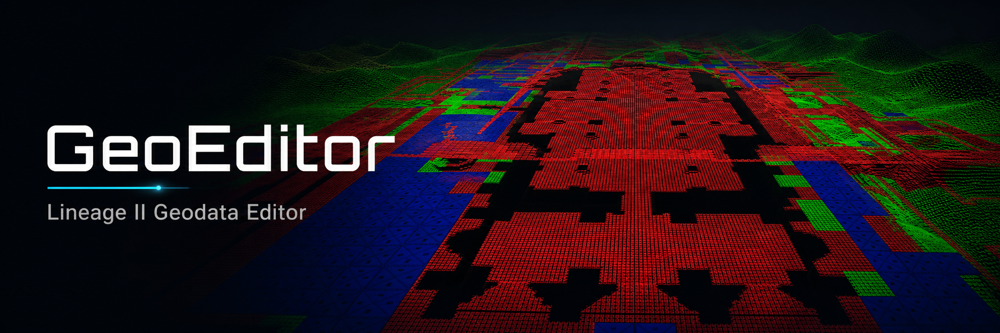

<p align="center">
  
</p>

<p align="center">
  Editor desktop para inspecionar, visualizar e modificar geodata de Lineage II.
</p>

<p align="center">
  
  
  
  
  
</p>

## Visao geral

GeoEditor 2.0.4.31 oferece um fluxo visual para trabalhar com geodata no formato
binario L2J. A interface usa JavaFX e a visualizacao 3D usa LWJGL/OpenGL. A
regiao ativa permanece editavel enquanto regioes vizinhas sao carregadas de
forma incremental para fornecer contexto.

## Recursos

- Visualizacao 3D de blocos `FLAT`, `COMPLEX` e `MULTILAYER`.
- Full Map com streaming incremental de regioes vizinhas.
- Grades circular e quadrada configuraveis.
- Selecao e edicao de blocos, camadas, alturas e bits NSWE.
- Conversao de blocos, restauracao, Undo/Redo e historico.
- Salvamento e recarga do formato L2J.
- Minimap, seletor de mapas, temas e estilos de ceu.
- Metricas de FPS, frame time, heap, memoria residente e VRAM.
- Testes deterministas para parsing, serializacao e transicoes de estado.

## Requisitos

- Windows 10 ou superior, x64.
- OpenJDK 25 x64 no `PATH`.
- PowerShell 5.1 ou superior.
- Driver grafico compativel com OpenGL.

## Dependencias de build versionadas

Execute a partir de `Geo_Editor`:

```powershell
powershell.exe -NoProfile -ExecutionPolicy Bypass -File .\tools\setup-javafx.ps1
powershell.exe -NoProfile -ExecutionPolicy Bypass -File .\tools\setup-lwjgl.ps1
```

As versões necessárias de OpenJFX, LWJGL e Launch4j ficam em
`Geo_Editor/tools` para permitir uma build reproduzível. Os scripts de setup
continuam disponíveis para recuperar essas dependências em um checkout limpo.

## Build e testes

Para executar a validacao e gerar o EXE com um unico comando:

```bat
Geo_Editor\BuildEditor.bat
```

O arquivo executa a suite deterministica e somente depois gera a distribuicao.
Os comandos separados para desenvolvimento continuam disponiveis:

```powershell
cd .\Geo_Editor

# Suite deterministica
powershell.exe -NoProfile -ExecutionPolicy Bypass -File .\tools\test-fast.ps1

# Compilacao e execucao do editor
powershell.exe -NoProfile -ExecutionPolicy Bypass -File .\tools\editor-app.ps1

# Distribuicao Windows
powershell.exe -NoProfile -ExecutionPolicy Bypass -File .\tools\package-exe.ps1
```

A distribuicao e gerada somente em:

```text
Geo_Editor/Build/
  GeoEditor.exe
  configs/
  data/
  libs/
```

`Build/` e regeneravel e nao deve ser versionada. O pacote usa o Java 25
instalado no sistema; nenhuma JRE e incorporada.

## Geodata local

O fixture local `Geo_Editor/src/main/resources/geodata/23_18.l2j` e usado pelos
testes deterministas e pelo fluxo de validacao. O empacotador o copia para
`Build/data/geodata/` quando o pacote e gerado.

Arquivos `.l2j` continuam ignorados pelo `.gitignore`; antes de publicar,
preserve somente os dados de teste autorizados para o repositorio privado.

## Estrutura

```text
Geo_Editor/
  java/                 core de formato e compatibilidade ainda utilizado
  src/main/java/        aplicacao JavaFX/LWJGL e core promovido
  src/main/resources/   icones, imagens e texturas de runtime
  tests/                suite Java deterministica
  tools/                build, testes, pacote e diagnosticos
  Build/                saida local regeneravel, nunca versionada
```

## Licenca e creditos

GeoEditor e distribuido sob a GNU General Public License, versao 3 ou posterior.
Veja [LICENSE.md](LICENSE.md) e preserve as atribuicoes em
`Geo_Editor/src/main/resources/textures/sky/ATTRIBUTION.md`.

Autor original: **Forsaiken (Patrick)**. Mantido e modernizado por **Maneco2**.
